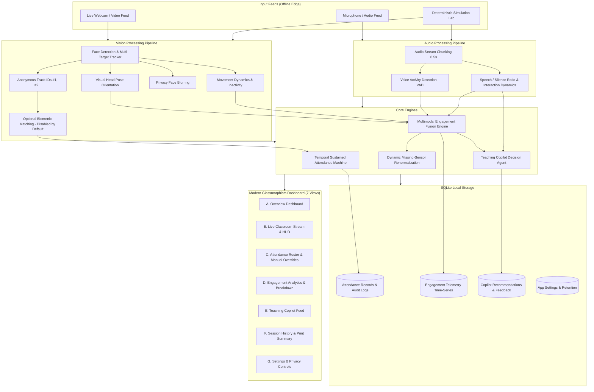

# ClassMind AI — Multimodal Smart Classroom Intelligence Platform

> **Smarter Classrooms. Better Insights. Privacy First.**

[](#privacy--ethical-charter)
[](#privacy--ethical-charter)
[](requirements.txt)
[](src/app.py)
[](tests/)

ClassMind AI is a production-grade, privacy-first edge intelligence platform that empowers instructors with real-time classroom analytics, automated sustained-presence attendance, multimodal activity indicators, and pedagogical decision support—running 100% locally on standard CPU hardware with zero cloud dependencies.

---

## 1. Key System Capabilities

### A. Automated Sustained Attendance Tracking (Module 1)
- **Temporal Sliding Observation Window**: Evaluates student presence across a configurable sliding observation window (default: $15\text{ s}$) requiring sustained appearance (default: $\ge 60\%$). Transient passersby walking through the door are categorized as **Unverified** and filtered out.
- **State Machine**: Supports **Present**, **Partial**, **Absent**, and **Unverified** states with grace periods for temporary occlusion.
- **Late Arrivals & Early Departures**: Flags students joining after the initial session threshold ($t > 300\text{ s}$) or departing prematurely (absent $> 60\text{ s}$).
- **Instructor Manual Corrections**: Allows instructors to review and override attendance with a mandatory audit rationale. Preserves a permanent, tamper-resistant audit trail in SQLite.
- **One-Click Exports**: Download structured session attendance reports as CSV or JSON.

### B. Multimodal Activity & Attention Indicators (Module 2)
- **Visual Attention Proxy (Head Pose)**: Estimates facial symmetry and vertical eye offset to quantify head yaw and pitch orientation (in degrees).
- **Movement Dynamics & Inactivity**: Optical frame differencing and Gaussian variance inside the upper-torso bounding box to detect active writing/gesturing versus prolonged slumber.
- **Classroom Acoustic Energy & VAD**: Local Voice Activity Detection (VAD) measuring RMS sound levels, speech-to-silence ratio, and continuous speech intervals.
- **Dynamic Missing-Sensor Weight Renormalization**: If a microphone or camera is disconnected, weights automatically renormalize over active inputs without penalizing engagement scores.
- **Rolling Trend & Confidence**: Calculates **Rising**, **Steady**, **Declining**, or **Insufficient Data** trends with sensory signal coverage metrics.

### C. AI-Driven Teaching Copilot (Module 3)
- **Assistive Decision Support**: Deterministic, explainable heuristics that detect attention shifts, monologue pacing, or discussion bursts.
- **Pedagogical Interventions**:
  - *Attention Drop Alert*: Triggers when visual attention drops below $45\%$ for $\ge 12\text{ s}$ across $> 40\%$ of participants.
  - *Extended Monologue Pacing*: Triggers when continuous speech exceeds $90\text{ s}$, recommending think-pair-share pauses.
  - *High Discussion Energy*: Detects collaborative discussion bursts and suggests synthesizing key takeaways on the board.
  - *Low Classroom Activity*: Identifies prolonged physical and vocal inactivity ($> 18\text{ s}$) and suggests energizers.
  - *Sensor Quality Issue*: Alerts the instructor if sensor signal coverage drops below $60\%$.
- **Anti-Spam Cooldowns & Feedback**: Enforces $20\text{ s}$ hysteresis cooldowns with instructor feedback controls (*Dismiss* and *Mark as Helpful*).

### D. Deterministic Simulation Lab (Hardware-Free Testing)
- Works completely out-of-the-box without requiring a physical webcam or microphone.
- Features dynamic student avatars exhibiting note-taking, attentive gaze, diverted attention, and scheduled arrivals/departures.
- Uses a fixed seed (`seed=42`) for 100% reproducible testing.

---

## 2. Architecture & Data Flow



---

## 3. Project Structure

```
Multimodal Attendance & Engagement Agent/
├── config.py                       # Global thresholds, privacy settings, & parameters
├── requirements.txt                # Pinned dependency requirements
├── run.py                          # Unified launch script
├── README.md                       # Comprehensive documentation
├── data/
│   ├── classroom_intelligence.db   # Local versioned SQLite database
│   ├── backups/                    # Timestamped database snapshots
│   ├── attendance_logs/            # Exported attendance audits
│   └── rosters/                    # Student enrolled profiles
├── src/
│   ├── app.py                      # FastAPI server with lifespan, WebSockets & streaming
│   ├── database.py                 # SQLite schema, transactions, migrations, & audit trail
│   ├── schemas.py                  # Pydantic request and response models
│   ├── dependencies.py             # FastAPI dependency injection
│   ├── pipeline.py                 # Multimodal pipeline orchestrator
│   ├── api/
│   │   ├── health.py               # Hardware health & diagnostics
│   │   ├── sessions.py             # Session lifecycle (start, pause, resume, stop)
│   │   ├── attendance.py           # Attendance summary, overrides, audit logs & exports
│   │   ├── analytics.py            # Engagement timeseries, sensor coverage & breakdown
│   │   ├── recommendations.py      # Teaching recommendations & feedback
│   │   ├── roster.py               # Enrolled student roster CRUD
│   │   └── settings.py             # System thresholds, privacy & data retention
│   ├── vision/
│   │   ├── face_tracker.py         # Multi-target face tracking & privacy blur
│   │   ├── head_pose.py            # Yaw/Pitch visual orientation proxy
│   │   ├── movement_detector.py    # Optical motion & prolonged inactivity
│   │   └── face_recognizer.py      # Privacy-first offline face recognizer
│   ├── audio/
│   │   ├── vad_processor.py        # Voice Activity Detection & RMS acoustics
│   │   └── interaction_tracker.py  # Conversational pacing & monologue intervals
│   ├── attendance/
│   │   └── sustained_presence.py   # Robust temporal attendance state machine
│   ├── fusion/
│   │   └── engagement_engine.py    # Multimodal feature fusion & weight renormalization
│   ├── agent/
│   │   ├── heuristics.py           # Pedagogical recommendation rules catalog
│   │   └── teaching_advisor.py     # AI Decision support copilot agent
│   ├── simulation/
│   │   └── classroom_simulator.py  # Deterministic synthetic simulation engine
│   ├── services/
│   │   ├── session_manager.py      # Session lifecycle & hardware status
│   │   └── export_service.py       # CSV and JSON report generators
│   └── ui/
│       ├── templates/
│       │   └── index.html          # Modern glassmorphism multi-view dashboard
│       └── static/
│           ├── css/style.css       # Custom dark theme, responsive & print styles
│           └── js/dashboard.js     # WebSocket streaming controller & modals
├── tests/
│   ├── test_attendance.py          # Sliding window, occlusion, & manual override tests
│   ├── test_engagement.py          # Weight renormalization & trend detection tests
│   ├── test_recommendations.py     # Copilot heuristics, cooldowns, & feedback tests
│   ├── test_database.py            # SQLite schema, audit logs, & snapshot tests
│   ├── test_simulation.py          # Fixed-seed reproducibility & scheduled arrival tests
│   └── test_api.py                 # End-to-end FastAPI endpoint tests
└── docs/
    ├── architecture.md             # System architecture blueprint
    ├── privacy.md                  # Privacy charter & ethical deployment guidelines
    └── model_setup.md              # Model sources, licenses, & hardware diagnostics
```

---

## 4. Installation & Getting Started

### 1. Prerequisites
- **Python**: Version 3.8+ (Python 3.11 recommended).
- **Hardware**: Standard x86_64 or ARM64 computer. Physical camera and microphone are optional.

### 2. Installation
Clone the repository and install dependencies in a clean virtual environment:

```bash
# Create virtual environment
python -m venv venv

# Activate virtual environment
# Windows:
venv\Scripts\activate
# Linux/macOS:
source venv/bin/activate

# Install requirements
pip install -r requirements.txt
```

### 3. Launching ClassMind AI

#### A. Synthetic Classroom Simulation (No Webcam or Mic Needed)
```bash
python run.py --sim
```

#### B. Live Hardware Mode
```bash
python run.py --camera 0
```

#### C. Privacy Face Blurring Enabled by Default
```bash
python run.py --sim --privacy
```

Once running, navigate to:
```
http://127.0.0.1:8080
```

---

## 5. CLI Command Reference

| Flag | Type | Default | Description |
|------|------|---------|-------------|
| `--sim` | Flag | `False` | Forces deterministic synthetic classroom simulation mode. |
| `--privacy` | Flag | `False` | Enables face anonymization (blurring) by default across all streams. |
| `--camera` | `int` | `0` | Specifies the physical webcam device index (e.g. `0`, `1`). |
| `--port` | `int` | `8080` | Specifies the web server port. |
| `--host` | `str` | `127.0.0.1` | Specifies the host binding IP address. |

---

## 6. REST & WebSocket API Documentation

FastAPI provides interactive OpenAPI documentation at `http://127.0.0.1:8080/docs`.

### Core Endpoints

| Category | Method | Endpoint | Description |
|----------|--------|----------|-------------|
| **Health** | `GET` | `/api/health` | Hardware diagnostics, sensor availability, and system status. |
| **Sessions** | `GET` | `/api/sessions` | Lists previous and active sessions with pagination. |
| | `GET` | `/api/sessions/current` | Retrieves the active session metadata and duration. |
| | `POST` | `/api/sessions` | Creates and starts a new classroom session. |
| | `POST` | `/api/sessions/current/action` | Executes lifecycle actions (`pause`, `resume`, `stop`). |
| **Attendance** | `GET` | `/api/attendance/summary` | Real-time verified attendance counts and student records. |
| | `POST` | `/api/attendance/correct` | Submits a manual teacher override with audit rationale. |
| | `GET` | `/api/attendance/audit-trail` | Retrieves the full audit trail of all manual corrections. |
| | `GET` | `/api/attendance/export/csv` | Downloads attendance report as a CSV file. |
| | `GET` | `/api/attendance/export/json` | Downloads attendance report as a JSON package. |
| **Analytics** | `GET` | `/api/analytics/timeseries` | Rolling multimodal engagement telemetry history. |
| | `GET` | `/api/analytics/summary` | Signal coverage, breakdown, and sensory health metrics. |
| **Copilot** | `GET` | `/api/recommendations` | Active explainable teaching recommendations. |
| | `POST` | `/api/recommendations/{id}/feedback`| Submits instructor feedback (`is_dismissed`, `is_helpful`). |
| **Settings** | `GET` | `/api/settings` | Retrieves current thresholds, weights, and privacy config. |
| | `POST` | `/api/settings` | Updates system parameters, thresholds, and weights. |
| | `POST` | `/api/settings/retention/prune` | Purges historical data older than configured retention days. |
| | `POST` | `/api/settings/backup` | Creates a timestamped SQLite snapshot in `data/backups/`. |
| **Streaming** | `GET` | `/video_feed` | Low-latency MJPEG stream with privacy blur overlays. |
| | `WS` | `/ws/telemetry` | Bi-directional WebSocket streaming telemetry every 750ms. |

---

## 7. Running Automated Tests

ClassMind AI includes a comprehensive automated test suite covering all critical engine workflows:

```bash
python -m unittest discover tests
```

### Verified Test Coverage (27 / 27 Tests Passed)
1. `tests/test_attendance.py`:
   - Initial unverified state evaluation
   - Transient glance rejection (filters pedestrians)
   - Sustained presence qualification ($> 60\%$ threshold)
   - Temporary occlusion tolerance (short absences keep student Present)
   - Teacher manual override with persistent audit trail
2. `tests/test_engagement.py`:
   - Full sensory coverage calculation
   - Missing audio sensor dynamic weight renormalization
   - Missing camera sensor dynamic weight renormalization
   - Trend analysis (*Rising*, *Steady*, *Declining*)
3. `tests/test_recommendations.py`:
   - Monologue pacing detection ($> 90\text{ s}$)
   - Anti-spam cooldown suppression
   - Sensor quality guards (disables visual alerts when camera is disconnected)
   - Feedback state persistence (*Dismiss* and *Mark as Helpful*)
4. `tests/test_database.py`:
   - Versioned schema creation and migrations
   - Foreign-key relationship consistency
   - Attendance and telemetry persistence
   - Snapshot backup generation
5. `tests/test_simulation.py`:
   - Fixed-seed reproducibility ($100\%$ identical frames)
   - Scheduled arrivals and early departures
   - Audio acoustic phase transitions
6. `tests/test_api.py`:
   - Health diagnostics endpoint
   - Current session lifecycle
   - Attendance summary and CSV/JSON export
   - Manual override flow
   - Settings retrieval and persistence

---

## 8. Privacy & Ethical Charter

1. **Local Edge Processing**: 100% of video and audio processing executes on the local device. No raw media is transmitted off-device.
2. **No Raw Frame Storage**: Video frames and audio waves are kept in volatile memory only for inference and immediately discarded.
3. **Face Anonymization**: Real-time Gaussian blur can be enabled to obscure facial identities on public classroom displays.
4. **No Emotion Claims**: Visual head orientation and physical motion are strictly **behavioral pacing proxies**. The system never claims to read emotions or cognitive potential.
5. **No Automated Penalties**: The platform is strictly an assistive aid for instructors. Scores must never be used to grade, rank, discipline, or penalize students.
6. **Data Retention & Audit**: Historical sessions can be pruned with a single click, and all manual changes preserve an audit trail.

---

## 9. License

Developed for academic and classroom intelligence research. Released under the Apache 2.0 License.
