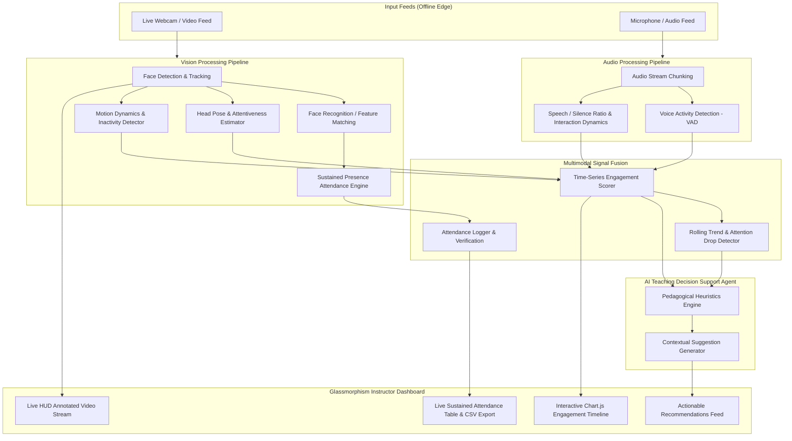

# Multimodal Attendance & Engagement Agent

[](README.md)
[](README.md)
[](requirements.txt)
[](src/app.py)

An AI-powered, privacy-preserving classroom intelligence system. The system integrates computer vision, audio signal processing, and agent-based reasoning to automatically track attendance, analyze engagement trends, generate AI-driven teaching suggestions, and provide student session analytics entirely offline.

---

## Key Scenarios Implemented

### Scenario 1: Automated Attendance Tracking
- **Sustained Presence Verification:** Replaces single-frame detection with sliding temporal observation windows (e.g. 15s window, requiring sustained presence > 60% of frames). This filters out transient passerbys and brief glances.
- **Automated Timestamped Logging:** Automatically records `first_detected`, `last_detected`, `sustained_seconds`, and verified status (`Present`, `Partial`, `Absent`) into local SQLite storage.
- **One-Click Export:** Download full attendance audit reports as CSV/JSON.

### Scenario 2: Engagement and Session Dynamics Analysis
- **Multimodal Signal Fusion:**
  - **Visual Attention (Head Pose):** 3D head orientation (Yaw, Pitch, Roll) and eye symmetry to estimate gaze (attentive forward vs. looking down at desk/phone vs. looking away).
  - **Movement Dynamics & Inactivity:** Optical frame differencing and motion variance to differentiate active participation from prolonged slumber/inactivity.
  - **Acoustic Activity & VAD:** Voice Activity Detection (VAD), speech-to-silence ratio, and interaction pacing.
- **Composite Engagement Index (0–100%):** Weighted fusion algorithm computing real-time classroom attentiveness with rolling 60-second trend detection (*Rising*, *Steady*, *Declining*).

### Scenario 3: AI-Driven Teaching Suggestions
- **Assistive Decision-Support Copilot:** Real-time heuristic and contextual reasoning engine that monitors engagement and acoustic indicators.
- **Context-Aware Interventions:**
  - *Attention Drop Alert:* Triggers when >40% of the class is disengaged, suggesting rapid check-in questions or polls.
  - *Monologue Pacing Alert:* Triggers during continuous speech exceeding 90 seconds, recommending think-pair-share pauses.
  - *High Interaction Peak:* Highlights fruitful discussion bursts and suggests synthesizing key board takeaways.
  - *Lethargic Classroom State:* Identifies prolonged motionlessness and suggests quick energizers.

---

## System Architecture



---

## Project Structure

```
Multimodal Attendance & Engagement Agent/
├── config.py                       # Global thresholds, privacy settings, & parameters
├── requirements.txt                # Pinned dependency requirements
├── run.py                          # Unified launch script
├── README.md                       # Complete documentation
├── data/
│   ├── classroom_intelligence.db   # Local SQLite database (auto-generated)
│   ├── attendance_logs/            # Exported attendance audits
│   └── rosters/                    # Student enrolled profiles
└── src/
    ├── database.py                 # SQLite schema, queries, & seed data
    ├── pipeline.py                 # Multimodal pipeline orchestrator
    ├── app.py                      # FastAPI server & streaming endpoints
    ├── vision/
    │   ├── face_tracker.py         # Multi-target face tracker & privacy blur
    │   ├── head_pose.py            # Yaw/Pitch 3D head pose attentiveness
    │   ├── movement_detector.py    # Motion dynamics & prolonged inactivity
    │   └── face_recognizer.py      # Offline face embedding & roster matcher
    ├── audio/
    │   ├── vad_processor.py        # Voice Activity Detection & RMS acoustics
    │   └── interaction_tracker.py  # Conversational pacing & speaker turnover
    ├── attendance/
    │   └── sustained_presence.py   # Sliding window attendance logic (Scenario 1)
    ├── fusion/
    │   └── engagement_engine.py    # Multimodal feature fusion (Scenario 2)
    ├── agent/
    │   ├── heuristics.py           # Pedagogical recommendation rules
    │   └── teaching_advisor.py     # AI Decision support agent (Scenario 3)
    └── ui/
        ├── templates/
        │   └── index.html          # Modern glassmorphic dashboard
        └── static/
            ├── css/style.css       # Custom dark theme with vibrant accents
            └── js/dashboard.js     # Real-time WebSocket/polling controller
```

---

## Getting Started

### 1. Prerequisites
- Python 3.8+ (Python 3.11 recommended)
- Standard webcam and microphone (or use the built-in synthetic simulator!)

### 2. Installation
```bash
pip install -r requirements.txt
```

### 3. Launching the System
To launch the agent with default settings:
```bash
python run.py
```

Then open your browser at:
```
http://127.0.0.1:8000
```

### Optional Command-Line Flags
- `--sim`: Force the synthetic classroom simulation mode (useful when testing without an active camera).
- `--privacy`: Enable face anonymization/blurring by default.
- `--camera <index>`: Select a specific webcam index (default: `0`).
- `--port <port>`: Change the web server port (default: `8000`).

---

## Privacy & Ethical Deployment
1. **100% Offline Execution:** All computer vision, audio processing, and AI reasoning execute on the local machine with zero external API calls or cloud data egress.
2. **On-the-Fly Anonymization:** Instructors can toggle facial blurring in the dashboard with one click.
3. **No Raw Video Persistence:** Raw camera frames are processed in-memory and discarded immediately; only anonymous statistical telemetry and attendance logs are retained.
